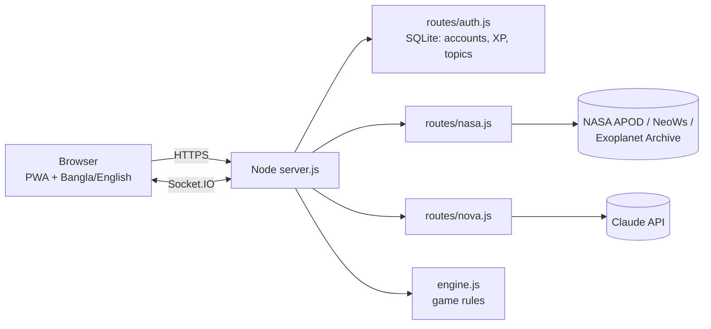

# SpaceSkribble – NASA Sky Challenge

A multiplayer astronomy **drawing and guessing game** for school students. Players log in, draw planets, galaxies and nebulae, guess each other's sketches, and learn real NASA facts after every round. Available in **English and বাংলা**, installable as an **offline-capable app**.

## What's new in this version
| Area | What changed |
|---|---|
| **Login first** | Every game page needs an account. Visitors are sent to `/login`; after login they land in the game (and invite links like `?room=ABCDE` still work). Sessions expire safely and the game socket only accepts logged-in players. |
| **Live NASA data** | "Space today" section: Astronomy Picture of the Day (APOD), near-Earth asteroids (NeoWs), newest exoplanets (NASA Exoplanet Archive). Fetched by our server, cached 1 hour, every card links to its NASA source. If NASA is unreachable we say so, never fake numbers. |
| **Real AI NOVA** | `POST /api/nova` calls Claude on the server (key never in the browser), grounded in our NASA fact sheet, replies in English or Bangla, shows NASA source links, rate limited. Without a key NOVA falls back to the old offline replies. |
| **Bangla mode** | `বাংলা` button on every main page; choice is remembered. NOVA also answers in Bangla. |
| **Classroom mode** | The host (teacher) picks a **topic** (e.g. only Planets) in the lobby and downloads a **class report CSV** when the game ends. |
| **Adaptive data** | Correct guesses are stored per topic (`/progress` returns `topics`) so revision rounds can target weak topics. |
| **Offline / low bandwidth** | Service worker + web manifest: the shell, images and CSS are cached; installable on phones. |
| **Single server** | Login, NASA, NOVA, multiplayer and the website run from one `server.js` (no more second server on port 3001, no hard-coded `localhost`). |
| **Security clean-up** | Removed `auth.db` and the default progress secret, `node_modules` ignored, rate limits on login, `helmet` headers, token expiry checked in the browser, open-redirect-safe `?next=`. |
| **Bug fixes** | Broken links `reg.html` / `log.html` fixed. |

## Run locally
```bash
npm install
cp .env.example .env     # then edit .env (see below)
npm start                # http://localhost:3000
```
Open the site → you land on **Login** → click **Create an account** → log in → play.

### `.env`
| Variable | Needed? | Meaning |
|---|---|---|
| `JWT_SECRET` | **Production: yes** | 32+ random chars. Locally a temporary one is generated. |
| `NASA_API_KEY` | recommended | Free at <https://api.nasa.gov>. `DEMO_KEY` works but is limited to ~30 requests/hour. |
| `ANTHROPIC_API_KEY` | optional | Turns NOVA into a real AI. |
| `NOVA_MODEL` | optional | Default `claude-sonnet-5-5`. |
| `AUTH_DB_PATH` | production | Where the SQLite file lives (use a persistent disk). |
| `CLIENT_ORIGIN` | if split hosting | Your website URL for CORS. |

## Deploy
**Easiest (everything on one host):** push to GitHub → Render → *New Web Service* (a `render.yaml` is included). Add `NASA_API_KEY` and `ANTHROPIC_API_KEY`. Done: one URL for site + API + multiplayer.

**Site on Netlify, API on Render:** deploy the backend first, then edit `public/config.js`:
```js
window.SS_CONFIG = { API_URL: "https://your-app.onrender.com" };
```
and set `CLIENT_ORIGIN=https://your-site.netlify.app` on Render.

## Architecture


## Project map
- `server.js` – web server + Socket.IO. `routes/` – auth, NASA, NOVA. `lib/db.js` – database.
- `public/engine.js` – ALL game rules (shared by server and browser local mode).
- `public/app.js` – game UI. `public/js/guard.js` – login gate. `public/js/i18n.js` – Bangla. `public/js/nasa-live.js` – NASA cards.
- `public/data/spaceObjects.js` – the 20 space objects with NASA references.

## Add astronomy objects
Copy an entry in `public/data/spaceObjects.js`, change `id`, `name`, `category`, `description`, `interestingFacts`, `observationGuide`, `stats`, `clues`, `images` (with credit), `nasaReference`, `sketch`. Put images in `public/assets/img/`.

## Still to do before submitting (your decisions)
1. **Pick one official 2026 Space Apps challenge** and write the 1-page story around it (who is helped, how). Judges score *Relevance* against a specific challenge; I can't verify the 2026 list, so check the official site.
2. Deploy and put the **live URL** in the submission, record the **2-minute demo** (login → Bangla → play a round → NASA card → NASA live section → class report).
3. Translate more of the game screens into Bangla (add keys to `public/js/i18n.js` and `data-i18n` attributes).
4. Later ideas from the roadmap: JPL Horizons "visible tonight from Dhaka", NASA GIBS satellite-imagery round, AR sky mode.
